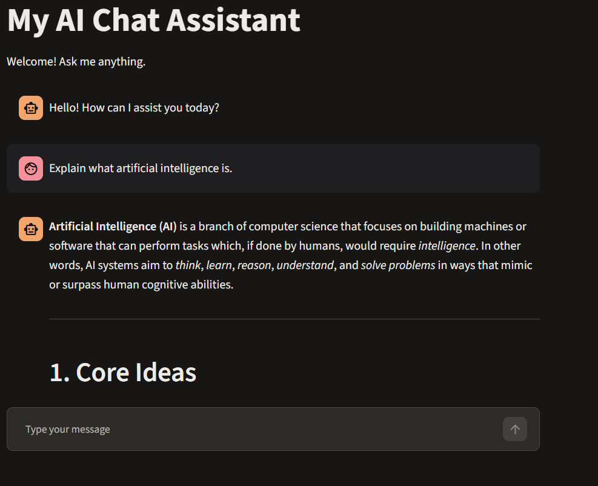

# My AI Chat Assistant

**Live Demo:** [Try the AI Chat Assistant](https://app-ai-chatbot-hfyrr3pgfkbvqvfcqp7y9z.streamlit.app)



A simple AI-powered chatbot built with Python and Streamlit, using the Groq API to generate responses.

I built this project as part of my journey into AI Engineering. The goal was to create a working chatbot while gaining practical experience with API integration, conversation memory, streaming responses and interactive web applications.

The application allows users to chat with an AI assistant, ask follow-up questions and maintain context throughout a conversation.

## Features

- **AI-powered conversations:** Chat with an AI assistant using the Groq API.
- **Conversation memory:** The chatbot remembers previous messages during the current session.
- **Streaming responses:** AI responses appear progressively as they are generated.
- **Chat history:** Previous messages remain visible during the conversation.
- **Clear Chat:** Start a fresh conversation whenever you want.
- **Error handling:** Displays friendly error messages while keeping technical errors available for debugging.

## Technologies Used

- Python
- Streamlit
- Groq API
- OpenAI-compatible chat completions API
- Git and GitHub

## AI Model

The application currently uses:

`openai/gpt-oss-20b`

The model is accessed through Groq's API.

## Project Structure

```text
streamlit-ai-chatbot/
│
├── .streamlit/
│   └── secrets.toml
│
├── app.py
├── requirements.txt
├── README.md
└── .gitignore
```

The `.venv` virtual environment is used locally and should not be committed to GitHub.

## Getting Started

Follow these steps to run the application on your computer.

### 1. Clone the repository

```bash
git clone YOUR_GITHUB_REPOSITORY_URL
```

Navigate into the project folder:

```bash
cd streamlit-ai-chatbot
```

### 2. Create a virtual environment

```bash
python -m venv .venv
```

Activate it on Windows PowerShell:

```powershell
.venv\Scripts\Activate.ps1
```

### 3. Install dependencies

```bash
pip install -r requirements.txt
```

### 4. Configure your Groq API key

Create a folder named `.streamlit` in the project directory.

Inside it, create a file named `secrets.toml`.

Add your Groq API key:

```toml
GROQ_API_KEY = "your_groq_api_key_here"
```

You can obtain an API key from the [Groq Console](https://console.groq.com/).

**Important:** Keep your API key private. Never upload `secrets.toml` or expose your API key in your source code.

### 5. Run the application

Start the Streamlit application:

```bash
python -m streamlit run app.py
```

Streamlit will open the chatbot in your web browser.

## What I Learned

Building this project helped me gain practical experience with:

- Connecting Python applications to external AI APIs.
- Managing conversation history with `st.session_state`.
- Building interactive interfaces with Streamlit.
- Implementing streaming AI responses.
- Handling API errors and debugging Python applications.
- Managing API credentials securely.
- Organizing Python project dependencies.

## Future Improvements

There are several features I would like to explore as I continue developing my AI Engineering skills:

- Add conversation export and download functionality.
- Support multiple AI models.
- Improve the chatbot interface.
- Add persistent conversation storage.
- Deploy the application online.

## Project Status

This is a learning and portfolio project. It represents one of my practical steps towards becoming an AI Engineer.

More improvements may be added as I continue learning and experimenting with AI technologies.

---

**Built with Python, Streamlit and Groq.**
